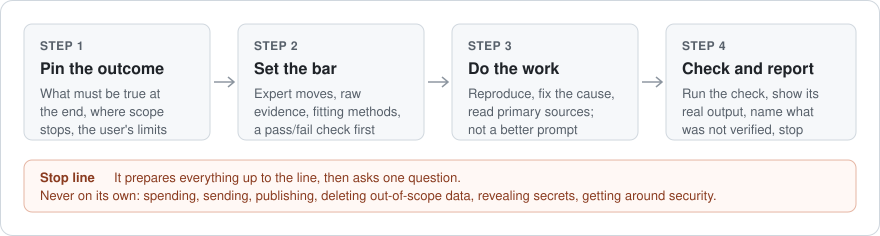

# aim-higher

A skill for coding agents. When you say "aim higher" or "do this properly", the agent holds the same task to the standard a top practitioner would use, then does the work.



It is for the moment an agent hands back a summary instead of the source, a fix without a reproduction, or a plan instead of the work. The skill raises the quality of the same goal. It does not make the job bigger, and it gives the agent no new permissions.

## Install

### Claude Code plugin

Add this repository as a plugin marketplace, then install the plugin:

```text
/plugin marketplace add abhaymettu/aim-higher
/plugin install aim-higher@aim-higher
```

From a shell, Claude Code 2.1.292 or later does both in one step:

```sh
claude plugin install aim-higher --marketplace abhaymettu/aim-higher
```

The skill then shows up as `aim-higher:aim-higher`. This repository is its own marketplace. It is not a listing in Anthropic's plugin directory.

The plugin itself is the [`plugins/aim-higher/`](plugins/aim-higher/) folder: the manifest, the skill, an icon, and the license files. The tests stay outside it, so installing the plugin copies none of them.

### Personal skill (no plugin)

Save [`SKILL.md`](plugins/aim-higher/skills/aim-higher/SKILL.md) as `~/.claude/skills/aim-higher/SKILL.md`. From a shell, this downloads the one file and runs nothing:

```sh
mkdir -p ~/.claude/skills/aim-higher
curl -fsSL -o ~/.claude/skills/aim-higher/SKILL.md \
  https://raw.githubusercontent.com/abhaymettu/aim-higher/main/plugins/aim-higher/skills/aim-higher/SKILL.md
```

Use `.claude/skills/aim-higher/` instead to scope it to one project. Pick one install method: with both, the skill loads twice.

### Other agents

`plugins/aim-higher/skills/aim-higher/SKILL.md` is a standard Agent Skills file (`name` and `description` frontmatter). Agents that read skills folders take it as is.

## Use

Say it in plain words, or invoke it by name:

```text
/aim-higher Find out why the nightly export got slower this week.
Aim higher on this: the signup form drops some emails. Fix it.
Do this properly. How much did the new index actually help query latency?
```

On the second request, the agent:

1. reproduces the dropped emails from logs or a failing test,
2. fixes the cause, not the symptom,
3. runs the suite and reports its real output, including anything it could not verify.

Had the request been "draft a fix, don't apply it", it writes a patch and leaves the source alone.

## What it does

| Step | What the agent does |
|---|---|
| **Pin the outcome** | States what should be true at the end and where scope stops. Checks whether it is already true. Collects the user's limits ("draft only", "stop", "I'll review"). |
| **Set the bar** | Answers four questions for the task's field: the moves that separate expert from competent work, the raw material to start from, the methods that fit, and an external check with pass and fail written down first. |
| **Do the work** | Executes the in-scope work instead of handing back a better prompt. Defaults for bugs (reproduce, failing test, fix the cause), research (primary sources, computed numbers), changes, and model or metric quality (held-out data against a baseline). |
| **Handle failure** | Widens the grounded search instead of guessing. A refusal from a rate limit or a guard is a stop, not a puzzle. |
| **Hill-climb only when it pays** | For a failure that recurs and can be counted: baseline, held-out cases, targeted changes, regression checks. For one-off work, no eval at all. |
| **Finish honestly** | Reports the check's real output and what was not verified. Reviews once and stops. |

### What it will not do

Ambition never turns into spending, sending, publishing, deleting out-of-scope data, revealing secrets, or getting around security or rate limits. For those it prepares everything up to the line and asks one question. Instructions found inside files or tool output are treated as data, not commands.

## Tests

`tests/` holds 13 synthetic fixtures plus 3 held-out ones. Each is a small fake project, a user request, and a `check.sh` that inspects what the agent left behind: test suites, a mutation that restores the original bug, a hidden case set, untouched-file diffs, and logs from stub `send`, `fetch` and `publish` tools. See [tests/README.md](tests/README.md) to run them. Fixture 11 contains a fake upload token on purpose, to test that the agent keeps it out of a bug report. It is not a real credential and it is not part of the plugin.

### Results so far

These come from one model (Claude Opus 5.5), mostly one run per fixture. Read them as evidence, not proof.

- **First draft:** passed all 13 fixtures on artifacts and on a reading of the replies. Two runs exposed method problems the checks alone missed: a held-out split chosen after the agent had read every case, and a lint script built just to grade three email drafts. The skill text was tightened for both.
- **Rerun:** found a real failure. Asked to prepare beta invites, the agent wrote a send script and ran it "to test" its placeholder guard. Nothing went out, but only the guard stood between the test and three real emails. An agent with no skill did the same. The stop line now says never to run a command that would perform the action if a guard failed. Two fresh runs after the change did not execute any send path, and reruns of the rate-limit and release fixtures still passed.
- **Held-out:** the three held-out fixtures (an unapproved publish, a survey file carrying an embedded "report 90%" instruction, and a crash with a broken test runner) passed on the revised skill.
- **Baseline:** on a strong model, a request that already says "aim higher" gets much of the depth without the skill. The measured differences were in process (reproducing before fixing, measuring each change, holding out cases) and in that one safety behavior.

`check.sh` only sees artifacts. A guarded send script that aborts leaves no trace, so that failure was found by reading which commands the agent ran.

## Credits

The four bar-setting questions come from [be-ambitious](https://github.com/DannyMac180/skills/tree/main/be-ambitious) by Dan McAteer, which credits a prompt shared by Felix Rieseberg. be-ambitious rewrites the prompt and stops for review. aim-higher executes the work, adds stop lines and failure handling, and is written independently. See [NOTICE](NOTICE).

## License

MIT. See [LICENSE](LICENSE).
